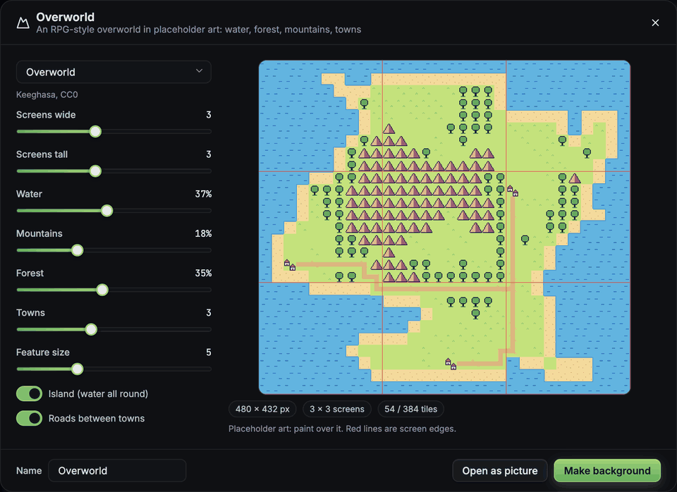
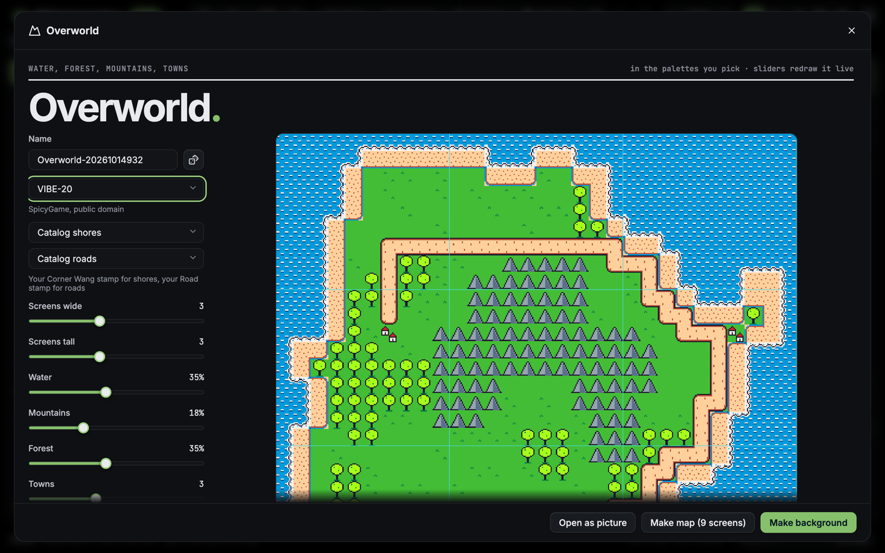
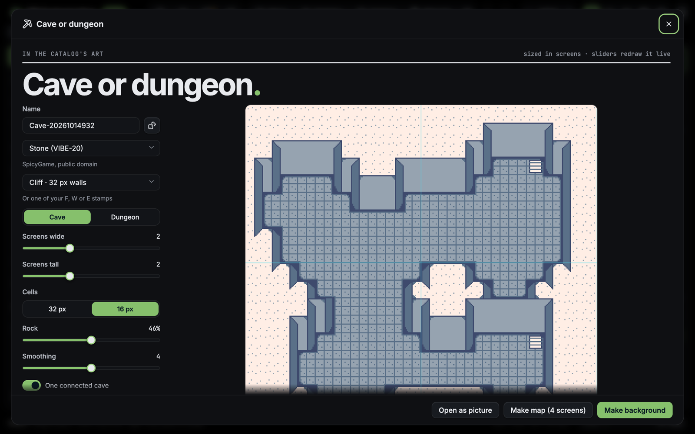
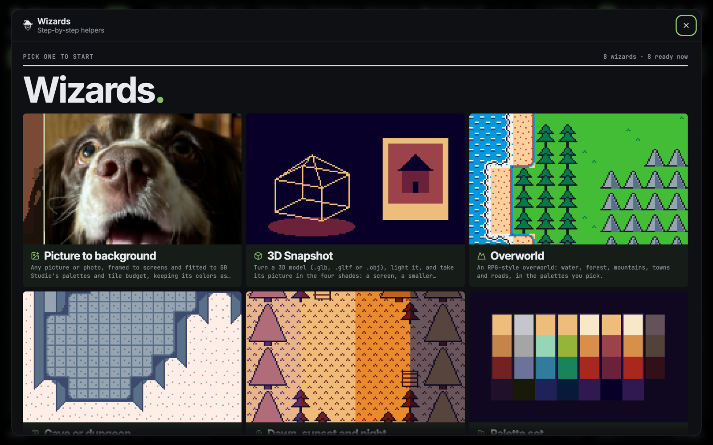
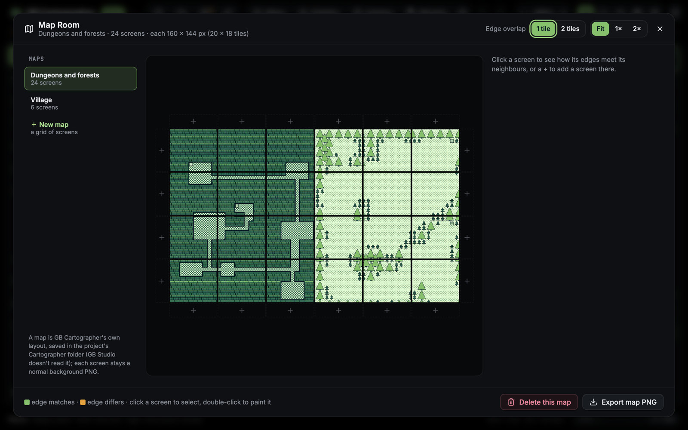
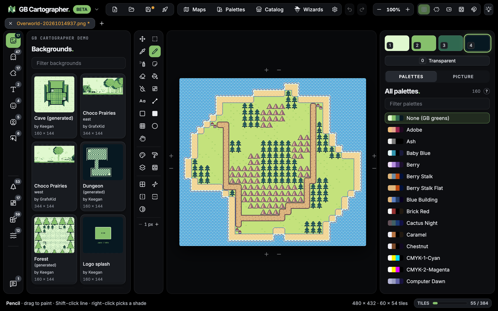
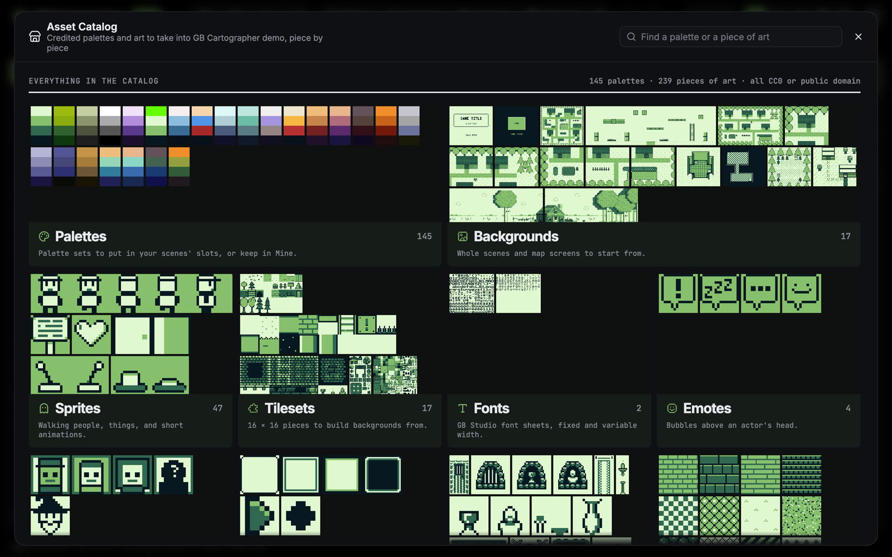

# GB Cartographer

**Alpha:** a pixel painting and color palette companion app for [GB Studio](https://www.gbstudio.dev) projects.
Paint backgrounds, sprite sheets, tilesets and fonts, give each tile its palette, and save the PNGs and per-tile
palettes straight back into the project.

> [!WARNING]
> **Experimental alpha.** Only use GB Cartographer on GB Studio projects you have backed up (a copy, or version
> control). It writes into your project when you save, features and file handling are still changing, and there
> will be bugs. Close GB Studio while you work, and please report problems in the repository's issues.
>
> GB Cartographer is free during the alpha.


| Spray | Select and move | Pencil |
| :---: | :---: | :---: |
|  |  |  |

<sub>The main screenshot shows GB Studio's sample project (`appData/templates/gbs2` in the [GB Studio repository](https://github.com/chrismaltby/gb-studio)), Copyright (c) 2019-2026 Chris Maltby, used under the MIT license. The art in these GIFs is the demo project's: Winter Tileset by Spencer "Raptorspank" Gerowe (CC0) and Free Furniture by yoanqwp (MIT, from the GB Studio Community Assets); see [demo/CREDITS.md](demo/CREDITS.md). It appears here only as screen recordings: the art files themselves aren't in this repository or the downloads.</sub>

**[Download the alpha](https://github.com/Keeghasa/GBCartographer/releases)** for macOS, Windows or Linux (see
[Install](#install)).

## Features

- **Open a GB Studio 4 project** (its `.gbsproj` or folder) and see its backgrounds, sprite sheets, tilesets,
  fonts, emotes, avatars and UI pictures as thumbnail cards, drawn in their real palettes. Or open any Game Boy
  PNG on its own, or an Aseprite file (`.aseprite` / `.ase`: its visible layers, frames side by side; it opens as a
  new PNG and the Aseprite file is never written).
- **One flat picture per file.** No layers, no tileset management: what you see is the PNG, kept in the four
  Game Boy shades, read exactly the way GB Studio reads colors. Sprite sheets and emotes keep their key green
  (`#65FF00`) for see-through pixels.
- **Paint directly with palettes.** The palette brush gives each 8 × 8 background or tileset tile (or 8 × 16
  sprite tile) one of its eight palettes, in 1, 2 × 2 or 3 × 3 tile steps, with Shift-click for straight lines and
  I to pick a tile's palette. Save writes them as GB Studio does: `tileColors`, or a sprite slice's `paletteIndex`.
- **Put a palette in a slot.** Right-click a palette (in the sidebar or the palette manager) to place it in one of
  the eight slots: the scene's palette list, or the project's default palettes. Right-click a slot to fill it with
  any project palette, rename or duplicate a palette from the same menu, or copy one background's eight palettes
  onto another's scene. The palette brush only paints with palettes that are in the slots. The optional **Time-of-day palettes**
  switch lets dawn / sunset / night versions (`Forest Trees D`, `S`, `N`) save as their base palette's slot.
- **A palette manager.** The project's palettes, a bundled library (Game Boy classics and the author's own CC0
  sets) and your own, with a live preview of the open picture; add palettes to the project or edit its own, and
  see which scenes use each one (unused and duplicate palettes are marked, and an unused one can be taken out);
  import palettes from Lospec `.hex` or GIMP `.gpl` files and export your own as JSON.
- **Asset Catalog.** Credited palette sets to take into a project, a whole set or one palette at a time: the author's
  Chorbi and Overworld sets (CC0), Game Boy screens, and SpicyGame's public-domain palettes, each with its license
  and source, plus links to Game Boy art on itch.io and OpenGameArt. And **Art**: 65 placeholder graphics (CC0) to
  add to a project and paint over in your own way: walking characters, things and animated things, emotes, avatars,
  window frames and cursors, tile sheets (with tall trees), whole scenes, a village cut into Map Room screens, a template for every auto-tile, and the author's **Outdoor pieces** as auto-tiles: a mound ledge that wraps any plateau you paint, pine and round forests that fill with a clump and ring themselves with single trees, and water in three animation frames whose shores fit (RPG Maker's 2 × 3 water layout, 16 px cells).
- **Wizards and generators.** A picture to a background, dawn / sunset / night versions of a scene's palettes (as painted, they're the day), a
  palette set from Lospec, any picture or the library, a new background with its palettes, a tile budget fixer, a
  project check-up, and live cave / dungeon and overworld generators that paint placeholder maps in your choice of
  palettes, drawn with your own auto-tile stamps if you like (the cave's walls, the overworld's shores and roads),
  as one background or cut into screens laid out in the Map Room.
- **The Map Room.** Lay backgrounds out as an adventure-style grid of screens, see whether neighbouring edges
  match, add a screen next to another, and export the whole map as one picture.
- **Palettes edited in place.** Click a shade square again to change that color; Save writes the recolored
  palette back into the project, and undo brings old colors back.
- **A draft layer** (Shift+D). Paint over the picture with any tool; the changes show tinted. Commit keeps them
  (one undo takes them back), Wipe puts the picture back as it was.
- **The usual tools.** Pencil, eraser, spray, line, rectangle, ellipse, fill (Alt-click replaces a shade
  everywhere) with fill patterns, eyedropper, select and move, flip and turn, mirror painting, brush sizes, undo,
  tabs, drag-and-drop, paste from the clipboard. Selections on tile edges take their tiles' palettes with them,
  even into another picture.
- **GB Studio collisions.** See a scene's collisions over its background (as GB Studio draws them) and paint them
  with the collision brush: solid, one-way sides, ladders and slopes, whatever the scene's type offers (a background
  in several scenes: pick the scene). A background GB Studio hasn't put in a scene says to add it there first.
- **Tile tools.** Linked tiles (paint one tile and every identical copy follows), a seamless view that repeats the
  tile under the pointer 3 × 3, a priority brush for tiles drawn over sprites, saved stamps with their palettes,
  auto-tile stamps (**9** box, **↔** / **↕** 3-slice, **P** path, **W** 47-tile Wang, **E** Wang edges, **C** corner
  Wang for two terrains, **F** wall faces, **▶** animated tiles, each with a template to draw over), and a text tool that types with the project's own font sheets (their GB Studio 4.3 character maps
  too).
- **New pictures and resizing.** Make a new background, sprite sheet or tileset in the project, or resize one in
  whole tiles.
- **GB Studio's limits in view.** A tile counter shows unique 8 × 8 tiles against the 192 / 384 budget (with a view
  of which tiles repeat), an overlay shows where each 160 × 144 screen falls, and Project health lists what GB
  Studio will trip on (sizes, tile budgets, missing sidecars, palettes) with a click to each one.
- **Screen looks and time of day.** See a picture as it shows on a Game Boy, a Game Boy Pocket or a Game Boy Color
  screen, or at dawn, sunset or night (its palettes' D, S and N versions, fading between them); the file stays as it is.
- **Sprite frames and font samples.** A sprite sheet shows its animations' frames above it (and plays them at GB
  Studio's speed, or walking over one of the project's backgrounds); a font sheet shows a sample sentence set in
  its own glyphs.
- **Export to share.** Any picture as shown, in its palettes, or in the greens, scaled up 2× to 8× with crisp pixels,
  and a sprite's animation as a looping GIF.
- **Tidy the project panel.** Pin the pictures you use most to the top, hide the ones you don't (they wait in a
  Hidden folder at the top that brings them back), duplicate one to make a variant, or delete one (asked every time;
  its files go to the backups).
- **Careful with your files.** The last 10 versions of every file it overwrites, restorable from **Backups…**; a
  warning when a file changed on disk (pictures GB Studio changes reload by themselves) or GB Studio is open; and a
  short, fixed list of what it ever writes (below).
- **Works offline**, with its fonts built in. **A demo project** to try it on (its art joins once its artists say yes).

## Screenshots

The generators: an RPG-style overworld and a cave or dungeon, redrawn live as the sliders move, in the palettes you
pick. Make background puts the map and its palettes in your project.



| | |
| :---: | :---: |
|  |  |
|  |  |





The pictures in these screenshots are GB Cartographer's own placeholders.

## Install

Download the file for your computer from the [latest release](https://github.com/Keeghasa/GBCartographer/releases).
The builds aren't signed yet, so the first launch needs one extra step:

- **macOS:** open the `.dmg` (`arm64` for Apple silicon, `x64` for Intel) and drag GB Cartographer to Applications.
  The first time you open it, macOS says it can't check the app for malware (checking needs a paid Apple developer
  account). Click **Done**, then open System Settings → Privacy & Security, scroll down and click **Open Anyway** next
  to GB Cartographer, then **Open Anyway** again. Or run this once in Terminal:
  `xattr -dr com.apple.quarantine "/Applications/GB Cartographer.app"`
- **Windows:** run the `windows-setup.exe` (or unzip the `.zip`). If SmartScreen says it protected your PC, click
  **More info**, then **Run anyway**.
- **Linux:** make the `.AppImage` executable (`chmod +x GB-Cartographer-*.AppImage`) and run it.

## Planned

- An itch.io page, and a tested Windows pass.
- The demo project's art, once its artists have said yes.

## GB Studio versions

GB Cartographer follows GB Studio: each release supports the newest GB Studio. When GB Studio changes its project
files, GB Cartographer follows in its next release, and this table says which version reads what.

| GB Cartographer | GB Studio | Project file format |
| --- | --- | --- |
| 0.1.0 (alpha) | 4.2.0 – 4.3.2 (newest checked: 4.3.2) | 4.2.0, release 10 |

A project from an older GB Studio (including GB Studio 3): open it in the newest GB Studio and save once (it
converts the project; keep a copy first), then open it here. A project saved by a newer GB Studio than the table
lists opens with a note: keep a backup and look for a GB Cartographer update.

## Try it with the demo project

`demo/` holds a small GB Studio 4 project: its scenes, palettes and settings. Its art isn't in the repository or
the downloads yet: it will join once each artist has given their blessing (credits in
[demo/CREDITS.md](demo/CREDITS.md)). Until then, open your own (backed-up) GB Studio project. When a build has the
demo, **Try the demo** on the start screen opens a copy of it (in the app's data folder, so the shipped copy stays
clean).

## What GB Cartographer writes into your project

GB Cartographer is careful with your game files. It only ever writes:

- the PNG you saved, under `assets/backgrounds`, `sprites`, `tilesets`, `fonts`, `emotes`, `avatars` or `ui`, with the same size as before (or the new size, after **Resize…**);
- a new PNG when you make one with **New**, a wizard, the Map Room or the Asset Catalog, or save a picture from another project into this one (it never replaces a file; GB Studio adds its own settings for it);
- the `tileColors` field of a background's or tileset's `.png.gbsres` sidecar;
- the `paletteIndex` of the slices in a sprite sheet's `.png.gbsres` sidecar;
- palette files in `project/palettes/`: a new one when you add or duplicate a palette, the name and
  colors of one you edit or rename, or taking out one that nothing in the project uses (it goes to the backups);
- a scene's `collisions` field in its `scene.gbsres`, when you paint collisions with the collision brush (only that
  field; the scene is backed up first, and one GB Studio changed since asks before it's replaced);
- when you put a palette in a slot: that one entry of a scene's palette list (`paletteIds` or `spritePaletteIds`
  in its `scene.gbsres`), or of the project's default palettes (`defaultBackgroundPaletteIds` or
  `defaultSpritePaletteIds` in `project/settings.gbsres`); and when you copy a background's palettes onto another
  background (**Copy** beside the scene slots), that scene's whole `paletteIds` list (the same palettes, no copies);
- its own folder, `Cartographer/`, beside `assets/` and `project/`: saved stamps in `Cartographer/stamps/` (a PNG
  each, its tile palettes, tags and auto-tile in a `.png.json` beside it), the Map Room's layouts in `Cartographer/maps.json`,
  the backups in `Cartographer/backups/`, a `README.txt` saying what the folder is and a `cartographer.json` saying
  its format. GB Studio doesn't read this folder; it travels with your project.

And when you **Delete** a picture (it asks every time), its PNG and sidecar move into GB Cartographer's backups.

Every other field of those files, and every other file in the project, is left untouched. Before each write the
old file is copied to the project's `Cartographer/backups/` (the last 10 versions of each file; **Backups…** in the project menu shows them and puts one back), and a file that changed on disk
since you opened it is never overwritten without asking. GB Studio 4 projects (the folder with `assets/` and
`project/`) are supported (see GB Studio versions above). A GB Studio 3 project needs opening and saving once in GB Studio 4
first. Colors other than the four greens shade exactly as GB Studio reads them (by their green channel), and a
background with GB Studio's Automatic color asks before saving, since a save in greens would lose its colors.

## Running it

```bash
npm install
npm run desktop        # the desktop app (builds first)
npm run dev            # or the page on a local dev server, http://127.0.0.1:5173
npm run dist           # installers for this computer, in release/ (dist:mac, dist:win, dist:linux)
```

A tag like `v0.1.0-alpha.1` makes GitHub build the installers for all three systems and publish them as a
pre-release (`.github/workflows/release.yml`, notes from `docs/releases/<tag>.md`).

In the desktop app, **Open project…** shows a file dialog: pick the project's `.gbsproj` file (or its folder). On the dev server it asks for the folder's path; you
can also set `GBC_PROJECT=/path/to/project` or write `{ "project": "/path/to/project" }` to
`cartographer.local.json` (not committed).

### Where GB Cartographer keeps its things

The desktop app keeps its settings (`settings.json`: the open project and recent ones) and the demo project's copy
(`demo-project/`) in its data folder:

| System | Data folder |
| --- | --- |
| macOS | `~/Library/Application Support/GB Cartographer` |
| Windows | `%APPDATA%\GB Cartographer` |
| Linux | `~/.config/GB Cartographer` |

Backups, saved stamps and Map Room layouts are kept in the project itself, in its `Cartographer/` folder, so they
travel with it to another computer. The backups keep the last 10 versions of every file GB Cartographer changed, so
the folder grows with the pictures you edit (leave it out of a copy if you don't need them). **Show backups folder**
in the project menu opens them. Backups made before 2026-10-12 lived in the data folder (`backups/<project>-<id>/`,
or `backups/` in the checkout for the dev server); the first time a project is opened they are copied into it and
the old folder is renamed `….moved-to-project`, never deleted. Open pictures and per-window choices (font, tint,
panels) live in the app's own browser storage.

`npm run install-mac-app` puts a GB Cartographer app in /Applications that runs this checkout; `npm run install-shortcut`
does the same on Windows.

## Keys

B pencil · E eraser · S spray · L line · R rectangle · Shift+R filled · O ellipse · G fill · Shift+G flood erase ·
I pick shade · P palette brush · M select · V move · H pan (or Space) · 1–4 shades · 0 see-through · [ ] brush size ·
Shift+M mirror · Ctrl+O open · Ctrl+S save · Ctrl+E export copy · Ctrl+Z / Ctrl+Shift+Z undo / redo ·
Ctrl+C / X / V · Ctrl+A · Ctrl+= / Ctrl+- zoom · Esc drop the selection.

## Checks

```bash
npm test
npm run build
```

## Credits and license

Code: MIT (see LICENSE). The logo is the author's pixel art, CC0. [Public Pixel](https://ggbot.itch.io/public-pixel-font)
by GGBotNet (CC0, shipped in `public/fonts/`) is an optional UI font. Inter by Rasmus Andersson and the Inter Project Authors, and JetBrains Mono by JetBrains, ship with the app (SIL Open Font License 1.1, licences in `public/fonts/`).
Bundled palettes: the author's own (CC0) and [SpicyGame's](https://spicygame.itch.io/palettes) (public domain), grouped into Game Boy palettes. Bundled graphics (the Art section): GB Cartographer's own placeholders, CC0. Other people's art appears only in this README's screenshots and GIFs, as pictures of the app at work: the demo project's art files aren't in the repository or the downloads until their artists have said yes (credits in [demo/CREDITS.md](demo/CREDITS.md)). GB Studio is by Chris Maltby and
contributors; GB Cartographer is not affiliated with it. The collision tile definitions (`src/gb/collisions.ts`) come from GB Studio's engine (MIT).
